# Winprove

Winprove is a Windows app for installing software, customizing Windows, monitoring your PC and running desktop and taskbar widgets.

This repository contains the installer, portable packages and update feed. The development repository is private.

## Downloads

Download the installer or portable ZIP from [Releases](https://github.com/colemclauchlan/Winprove-Updates/releases).

These are **unsigned development previews** for **Windows 10 2004 or later and Windows 11, x64**. The installer doesn't yet have a production Windows signing certificate.

Setup can install for your Windows account or extract a portable copy to a folder. A separate portable ZIP is also available. Portable preferences stay in the adjacent `Data` folder; move it with the app.

## Winprove Bar

Open the Bar from the status pill, tray icon or keyboard shortcut. Pin apps, files, folders and links to the hotbar. Added widgets appear in the sidebar; hotbar pins are configured separately.

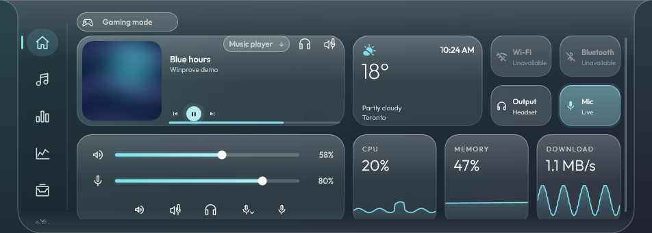

*These previews use sample data rendered by Winprove's native UI.*

| Tab | Controls |
| --- | --- |
| **Home** | Media, weather, time, quick controls, audio sliders and resource cards. Cards can be rearranged. |
| **Media** | Audio-source selection, artwork, timeline, playback, shuffle/repeat, mixer and output selection. |
| **System** | CPU, GPU and memory readings, a choice of graph styles and top processes. |
| **Network** | Adapter and IP details, upload/download rates, latency and per-process traffic. |
| **Tools** | A featured Timer or utility, two labeled or four icon shortcuts, power actions and editable utility tiles. |
| **Shelf** | Files, text, pinned shortcuts and clipboard history, with search, copy, open and clear actions. |
| **Devices battery** | Readings for supported wireless devices, display styles, names, icons, scanning and visibility settings. |

<table>
  <tr>
    <td width="50%"><strong>Media</strong> <a href="docs/images/bar-media.png">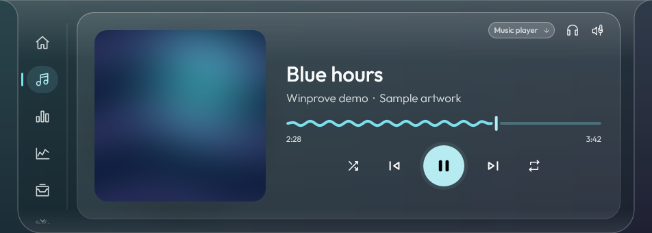</a></td>
    <td width="50%"><strong>System</strong> <a href="docs/images/bar-system.png">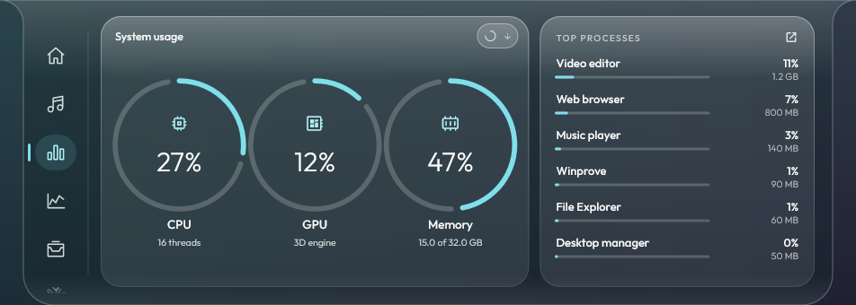</a></td>
  </tr>
  <tr>
    <td><strong>Network</strong> <a href="docs/images/bar-network.png">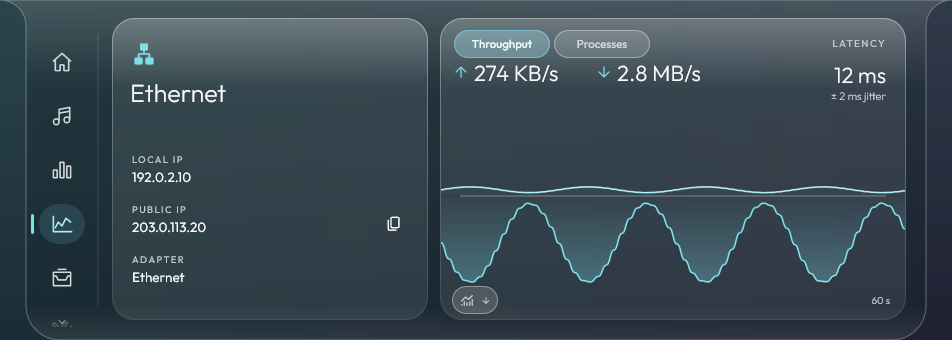</a></td>
    <td><strong>Tools</strong> <a href="docs/images/bar-tools.png">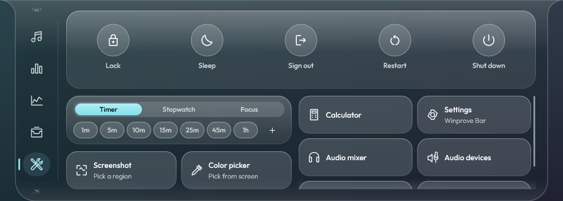</a></td>
  </tr>
  <tr>
    <td><strong>Shelf</strong> <a href="docs/images/bar-shelf.png">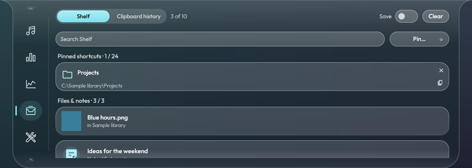</a></td>
    <td><strong>Devices battery</strong> <a href="docs/images/bar-devices.png">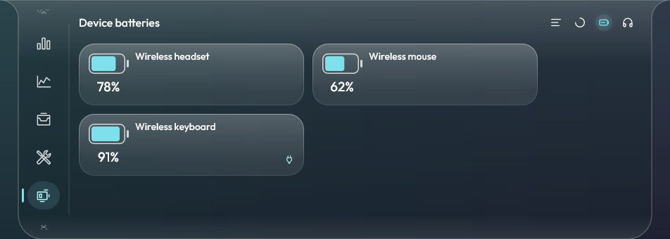</a></td>
  </tr>
</table>

Use **Tools layout** in Bar settings to choose the large card. Keep Timer with custom durations, stopwatch and focus sessions, or choose from 24 tools such as Screenshot, Audio mixer, Calculator, clipboard history and system resources. Pins beneath it can show two labeled cards or four compact icons. The remaining selected tools stay in the utility grid, without repeating the featured tool or visible pins.

<table>
  <tr>
    <td width="50%"><strong>Featured screenshot controls</strong> 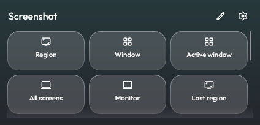</td>
    <td width="50%"><strong>Featured audio mixer</strong> 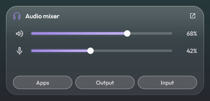</td>
  </tr>
  <tr>
    <td><strong>Two labeled shortcuts</strong> 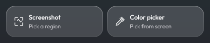</td>
    <td><strong>Four icon shortcuts</strong> 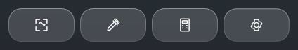</td>
  </tr>
</table>

### Bar settings

Settings is always the last icon in the sidebar. Its collapsible groups cover appearance, layout, the status pill, notifications, tools, media and advanced options. Right-click a Home card and choose **Customize** to rearrange cards.

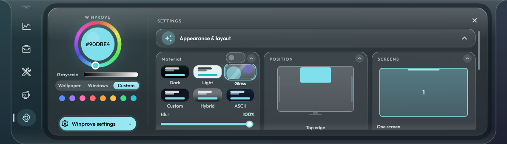

The status pill can show readings, time and media, with options for persistent visibility, left/right information, hover playback and timer bubbles. More widgets, including calendars, clocks, notes, reminders and Smart Stacks, can be added to the sidebar.

With the Bar along the top edge, double-click its empty top or bottom center to close it. The first click shows a semicircular pulse.

**Gaming mode** on Home uses the same setting as **Settings → Background → Lite mode**. The controller icon expands on hover and stays open with **Enabled** while the mode is on, in both the hub and Bar. It pauses tracking, sensors, traffic capture, automatic scans and update checks, media observation and animated wallpapers, and reduces animations. Turning it off restores your saved choices. Manual tools and enabled Windows mods remain available. Downloads and Windows changes already in progress aren't interrupted.

## FPS display

Add FPS display from Widgets, or enable its corner overlay in Windows Mods. It also works in the Bar, Windows taskbar and on the desktop.

Settings include a program whitelist, persistent display, four screen corners and visibility switches for full-screen apps, the desktop, minimized windows and missing frames. Detailed mode adds frame time, 1% low, CPU, GPU, memory and available temperatures. Capture pauses in Gaming / Lite mode by default.

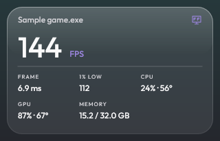

FPS counts the app's frame submissions, which can differ from frames shown on screen. Missing readings appear as a dash. Protected games and exclusive full-screen overlay compatibility are still being tested.

## Clean URLs

Find it in **Windows Mods → Privacy → Clean URLs**. Automatic cleaning is off until you enable it. Winprove then cleans plain-text clipboard links before you paste or share them; formatted copies and links typed directly in other apps stay unchanged.

Choose whether to remove campaign tags, advertising IDs and social tracking, unwrap supported redirects, or clean links inside messages. Add excluded domains to leave those sites alone. **Try a link** shows the result before you copy it.

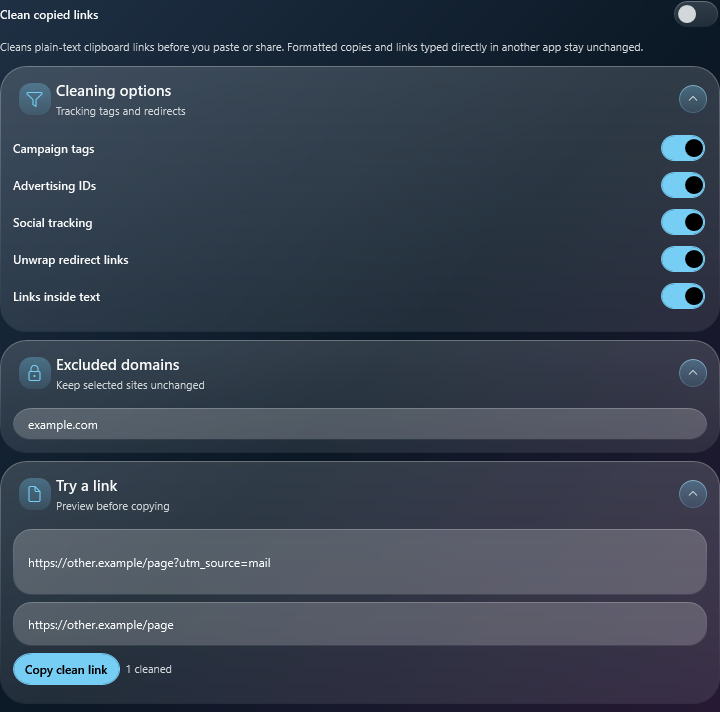

## Ad blocking

Open **Windows Mods → Privacy → Ad blocking**. The bundled filters cover 6,570 unique domains. Choose ads and common trackers, extra analytics, allowed domains and custom blocked domains. The preview shows the proposed count before you apply changes.

Winprove backs up the hosts file and edits only its own marked rules. Switching the mod off removes those rules. Apps using a separate resolver or proxy can bypass them, and ads on the content's own domain cannot be blocked separately. Restart your browser if cached connections keep using the old rules.

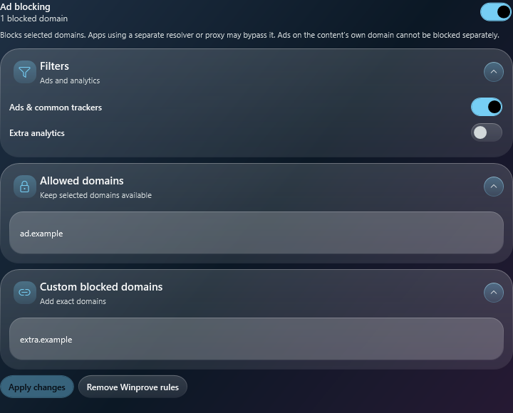

## Telemetry

**Windows Mods → Telemetry** has 25 reviewable controls for diagnostics, advertising, activity history, suggestions and browser reporting. These include Windows Error Reporting and Chrome/Firefox reporting switches. Changes use the same detection, review, apply and undo flow as System Customization.

These controls do not guarantee zero telemetry. Windows Home and Pro can still send required diagnostic data, and required service data is separate.

## Compatibility

- Media actions depend on the selected app. Seeking, shuffle and repeat require that app's Windows playback support.
- Battery readings require supported connected devices.
- Per-process traffic requires a one-time administrator-approved collector setup.
- FPS capture may need a one-time Windows approval to set up its bundled collector.

## Updates

Configured preview installations check this repository without a GitHub account or token. Packages must pass signature and version checks before installation. Signatures are verified against the Ed25519 key bundled with Winprove; this is separate from Windows code signing.

Updates keep your preferences, profiles, layouts and logs.

## Required source and notices

Each release includes source archives and required license notices. Keep those files when redistributing packages. Publishing release sources doesn't make the development repository public.
